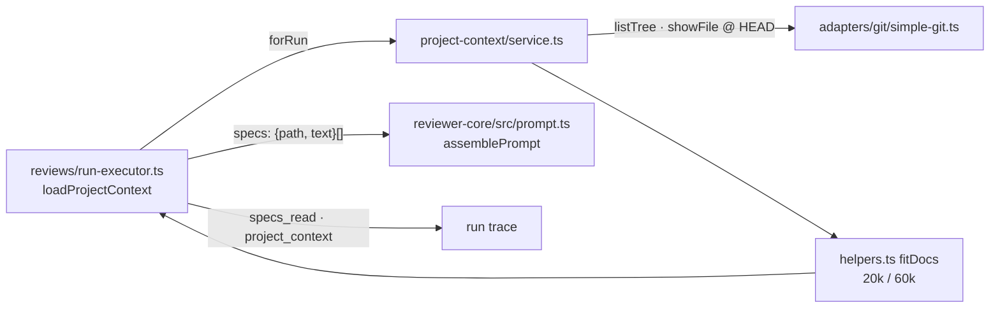

# modules/project-context

L05 — repo Markdown documents attached to an agent or a skill and injected into review
runs. Spec: `specs/L05-project-context.md`. Service: `container.projectContext`
(`platform/container.ts`), also used by `modules/reviews/run-executor.ts`.

## Shape
`routes.ts` → `service.ts` (use cases) → `ports.ts` (`ContextRepo`, `EffectiveSkillsSource`,
`DocSource` = `GitClient.listTree` + `showFile`) → `repository.ts` (Drizzle, tables
`agent_context_docs` / `skill_context_docs` in `db/schema/context.ts`). Pure logic
(discovery, effective list, limits, row building) is in `helpers.ts`; limits and excluded
folders in `constants.ts`.

## Routes
- `GET /repos/:id/context` → `SpecFile[]` (path, category, size, tokens, `used_by`)
- `GET /repos/:id/context/file?path=` → `SpecFile` with content; undiscovered path → 404
- `GET|PUT /agents/:id/context` · `GET|PUT /skills/:id/context` → `ContextAttachments`
  (`?repo_id=` on GET; `{repo_id, paths}` on PUT replaces the whole ordered list)

## Rules
- **Discovery reads git objects, never the working tree:** `git ls-tree -r -l -z --full-tree HEAD`
  (`adapters/git/simple-git.ts` `listTree`) and `git show HEAD:<path>` (`DOC_REF`). `.md` blobs
  outside `EXCLUDED_DIRS` (a copy of repo-intel's list) are listed; submodules are dropped.
- **Symlinks:** a link is listed under its own path only if its text resolves, one hop, to a
  regular `.md` blob inside the tree (`resolveTreeLink`); absolute, escaping, chained or
  dangling links are dropped. Link text comes from `showFile`, no on-disk link is followed.
- **Effective list** (`effectiveDocList`): agent's own paths first, then its effective skills'
  paths in skill order; each path once, `via` names the skills carrying it.
- **Limits** (`fitDocs`): a doc over `MAX_DOC_CHARS` = 20,000 is cut (not inside a surrogate
  pair) and gets a visible marker; then later docs are dropped (`omitted`) once the running
  total would pass `MAX_TOTAL_CHARS` = 60,000. The marker is not counted. Tokens = ceil(chars/4).
- **Writes** (`validatePaths`): duplicates → 422; every path must be discovered or already
  stored for that owner+repo (so a `missing` doc survives a reorder). No clone → 409; git
  error → 502 with a redacted message.
- **`forRun` is best-effort and called once per run.** Missing repo or no attachments → empty;
  unreadable / no longer discovered paths go to `skipped`. The executor passes the result by
  value and catches any error (`run-executor.ts` `loadProjectContext`), so a failure never
  fails the run.

## Run flow

Run → `forRun` → limits → `assemblePrompt`; the same list feeds the trace.

## Live Log and prompt
- Lines carry paths and counts only, never document text: `Project context: N doc(s) — +T tokens`,
  `… none attached`, `… skipped <path> (not readable)`, `… omitted <path> (over the 60,000-character budget)`,
  `Project context unavailable (<redacted>) — reviewing without it`.
- Each doc is one `<untrusted source="<path>">` block under `## Project context`;
  `wrapUntrusted` escapes the label (paths are attacker-controlled). Never bypass it.
- Trace: `specs_read` = injected paths; `project_context` = `TraceSpecDoc[]` with status
  `injected` / `truncated` / `omitted`.

## Gotchas
- Docs are read at `HEAD` as of the last sync, not the live branch.
- `used_by` counts every agent of the workspace, enabled or not.
- Don't import `repo-intel`; modules don't import each other.
